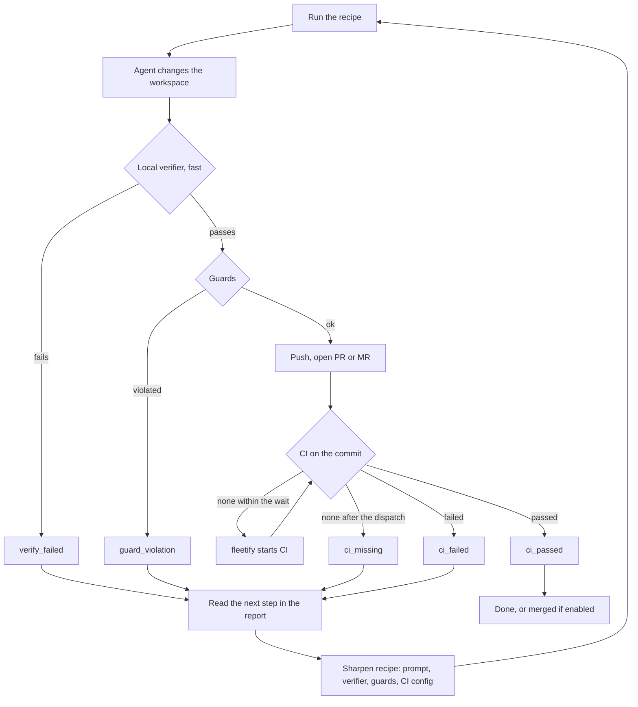

# fleetify

Run one change across many Git repositories. For each repository, an optional
coding agent works in its own local clone. A fast verifier checks the result
before anything leaves the machine. Then fleetify pushes a branch, opens a pull
or merge request, waits for CI, and merges only if you enabled that explicitly.

**Status:** early development. `PLAN.md` holds the design and milestones,
`DECISIONS.md` the decisions taken along the way.

## Concepts

- **Repository list.** A text file, one repository per line: `github:owner/name`,
  `gitlab:group/name` or a clone URL. Other hosts are declared in `config.toml`.
- **Recipe.** A directory with `recipe.toml`, prompts and `tools/` scripts. It
  says which repositories it applies to (`applies_to`), what the agent should do
  (`instructions`), how to verify (`verify`), what may change (`guards`) and how
  CI is handled (`ci`). A recipe without instructions runs no agent, only
  `prepare` and `verify`.
- **Workspace.** Each run clones the repository locally into its own folder. The
  agent can only work there. Your normal checkouts are never touched.
- **Verifier.** A command that decides whether the change is acceptable. It has
  two jobs with different demands:
  - **Local (before CI).** It runs right after the agent, on the same machine.
    It must be fast, because a slow check here slows every repository. It runs
    the cheap checks: formatting, lint, lock consistency, a small test
    selection. A failure goes back to the agent with the output.
  - **CI (after the push).** The full suite. CI is the authority.
- **Guards.** Rules on the diff, independent of the verifier: allowed paths,
  file and line limits, no deleted tests, no binary files, no added suppression
  markers. A guard violation stops the repository before anything is pushed.
- **CI gate.** After the push, fleetify waits for the CI result on exactly that
  commit. If the host has started no CI within `[ci] dispatch_after_s` (default
  180 s), fleetify starts it: `workflow_dispatch` on GitHub (`ci.dispatch_workflow`
  in the recipe), a pipeline on GitLab. `0` starts it at once.
- **Results.** Each repository ends with one result, such as `pr_open`,
  `ci_passed`, `ci_failed`, `ci_missing`, `ci_timeout`, `ci_blocked`, `merged`,
  `guard_violation`, `base_broken` or `needs_input`. A failure always carries a
  `failure` block with a message, so the report is enough to act on.
- **Report.** `report.json` per run, plus an event log. Automated callers read
  the exit code and the report.

## The feedback loop

The verifier is never final on its own. The local check is fast and runs before
anything is pushed; CI is the authority after the push. Every run feeds its
results back into the recipe:



After every run, fleetify prints a **next step** for each repository that did
not succeed. The same text is in `report.json` (`failure.next_step`). Work
through the failures like this:

1. **`ci_failed` although the local verifier passed:** the local check is too
   weak. Add the missing check to `verify`, so the same failure is caught before
   the push.
2. **`verify_failed`:** nothing was pushed. Read the output tail, then fix the
   instructions or the verifier.
3. **`guard_violation`:** the agent changed something it should not have. Tighten
   the instructions. Widen `allow_paths` only if the change is wanted.
4. **`ci_missing` or `ci_timeout`:** check the workflow trigger and
   `ci.dispatch_workflow`, or the timeout.
5. **`needs_input`, `blocked`:** the task was unclear or a version could not be
   made to work. Make the instructions more specific.

Change the recipe, run it again on the same repositories, and compare the new
report with the old one.

### CI fix rounds

When CI fails on the pushed commit, fleetify can hand the failure to the agent once
more. The agent gets the failing jobs, first failure first, each with the end of its
log in `.agent/ci-failure.md`. Its change goes on top of the branch, through the same
verifier and guards, and CI is waited for again. The loop never merges and never opens
a second change request.

```toml
# recipe.toml: how many fix rounds the agent gets (0 turns the loop off; default 1)
[ci]
wait = true
fix_rounds = 1
```

```toml
# config.toml: how much of each failed job's log the agent sees (default 100 lines
# or 1000 characters, whichever is smaller)
[ci]
log_lines = 100
log_chars = 1000
```

Each round is shown as `fix round N`, with the failing jobs by name, followed by the
phases of the agent, verifier, guards and push.

## Usage

```sh
fleetify validate ~/.fleetify/recipes/my-recipe     # schema, files, rendered commands
fleetify run ~/.fleetify/recipes/my-recipe repos.txt --dry-run
fleetify run ~/.fleetify/recipes/my-recipe repos.txt --format json --report report.json
fleetify report --run NAME                          # render a finished run
fleetify status --watch                             # per-repo state while a run is active
fleetify logs <repo> -f                             # tail the agent log of one repository
fleetify check-agent claude-code --model NAME       # canary: is the agent confined?
```

Configuration and credentials live together in `~/.config/fleetify/`:
`config.toml` (no secrets) and `credentials.toml` (tokens, owner-only permissions).
`--config FILE` moves both (the credentials sit next to the config file), and
`$XDG_CONFIG_HOME` is honoured. The working directory `~/.fleetify/` holds the clones,
runs and logs. A minimal `[ci]` section:

```toml
[ci]
dispatch_after_s = 180   # 0 starts CI at once; unset means 180
```

`fleetify schema` prints the JSON Schema of `recipe.toml`. The Python package
in `authoring/` generates recipes against that schema.

## Build

```sh
cargo build --release
./target/release/fleetify --help
```


## Origin and notice

**Inspiration.** The core idea (existing fleet-management tooling for changes across many repos, with a coding agent plugged in and verifiers checking the result) comes from Spotify's public engineering articles about their background coding agent (called "Honk" at Spotify). The name `fleetify` is a nod to the term "Fleet Management" used there. Ideas were taken, no code:

- "1,500+ PRs Later: Spotify's Journey with Our Background Coding Agent (Honk, Part 1)", <https://engineering.atspotify.com/2025/11/spotifys-background-coding-agent-part-1>
- "Background Coding Agents: Context Engineering (Honk, Part 2)", <https://engineering.atspotify.com/2025/11/context-engineering-background-coding-agents-part-2>
- "Background Coding Agents: Predictable Results Through Strong Feedback Loops (Honk, Part 3)", <https://engineering.atspotify.com/2025/12/feedback-loops-background-coding-agents-part-3>

> `fleetify` is an independent project. It is **not a product of Spotify**, is **not affiliated with, endorsed by, sponsored by or developed in collaboration with Spotify**, and uses no Spotify code. The name and design are inspired by Spotify's public engineering articles on its background coding agent, linked above. "Spotify" is a trademark of Spotify AB. All other product names (GitHub, GitLab, Claude Code, GitHub Copilot, opencode, SonarQube and others) are trademarks of their respective owners and are used for identification only.

German version: `fleetify` ist ein eigenständiges Projekt. Es ist kein Produkt von Spotify, steht in keiner Verbindung zu Spotify, wird weder von Spotify unterstützt noch gefördert und ist keine Kollaboration mit Spotify. Es enthält keinen Spotify-Code. Name und Konzept sind von den öffentlichen Engineering-Artikeln von Spotify inspiriert, die oben verlinkt sind. "Spotify" ist eine Marke der Spotify AB. Alle anderen genannten Produktnamen sind Marken ihrer jeweiligen Inhaber und dienen nur der Bezeichnung.

## License

MIT, see `LICENSE`.
