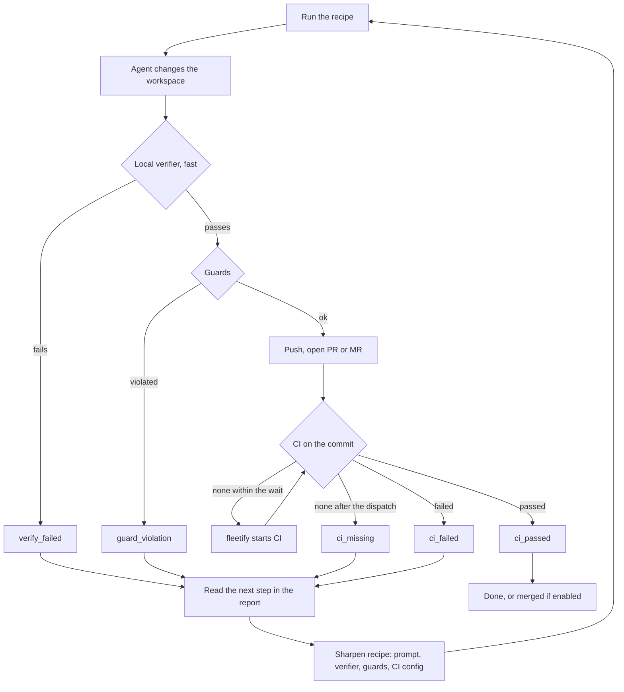

# fleetify

Run one change across many Git repositories. For each repository, an optional coding agent works in its own local clone. A fast verifier checks the result before anything leaves the machine. Then fleetify pushes a branch, opens a pull or merge request, waits for CI, and merges only if you enabled that explicitly.

**Status:** early development. This README is the entry point; the detail lives in `docs/`, `tasks/` and `DECISIONS.md`.

## Where things stand

Built and merged:

- One recipe over many repositories on GitHub and GitLab, with Claude Code, opencode and Copilot CLI as agents.
- Verifier and guards before the push; one commit per repository; pull or merge request; an explicit merge rule.
- CI gate on the pushed commit. If the host started no CI, fleetify starts it (`workflow_dispatch` on GitHub, a pipeline on GitLab).
- CI fix rounds: the agent gets the failed step's log and fixes the branch, bounded by `fix_rounds`.
- Recipe base branch, a next-step hint for every unsuccessful repository, and `report.json`.

Tested: unit and integration tests in `tests/`; real runs on GitHub and GitLab, listed in `E2E-MATRIX.md`; a trial on a public fork, see `DECISIONS.md`.

Known limits: Windows is not verified yet, self-hosted GitLab has not run against a real instance, the real trial on company repositories has not started.

## What is next

The open work is one file per item in [`tasks/`](tasks/README.md). The first two:

1. [Bug: host errors without an endpoint](tasks/bug-host-error-endpoint.md).
2. [Real trial](tasks/m17-real-trial.md) on three to five private repositories, once the repositories and the task are given.

## What can go

- `PLAN.md`: dissolved. Its design is in `docs/design/`, its open items in `tasks/`.
- Trial recipes in `~/.fleetify/recipes/` on the development machine. They are not part of the repository and reference repositories that no longer exist. Delete them when no one needs them.
- Old test branches and pull requests on GitHub: removed with the `fleetify_clean` skill after each trial (`.claude/skills/fleetify_clean/`).

## Concepts

- **Repository list.** A text file, one repository per line: `github:owner/name`,
  `gitlab:group/name` or a clone URL. The host comes from the URL. A self-hosted host is
  declared in the recipe: `[hosts."gitlab.example.com"] type = "gitlab"`.
- **Recipe.** A directory with `recipe.toml`, prompts and `tools/` scripts. It
  says which repositories it applies to (`applies_to`), what the agent should do
  (`instructions`), how to verify (`verify`), what may change (`guards`) and how
  CI is handled (`ci`). A recipe without instructions runs no agent, only
  `prepare` and `verify`.
- **Workspace.** Each run clones the repository locally into its own folder. The
  agent can only work there. Your normal checkouts are never touched.
- **Verifier.** A command that decides whether the change is acceptable. It has
  two jobs with different demands:
  - **Local (before CI).** It runs right after the agent, on the same machine.
    It must be fast, because a slow check here slows every repository. It runs
    the cheap checks: formatting, lint, lock consistency, a small test
    selection. A failure goes back to the agent with the output.
  - **CI (after the push).** The full suite. CI is the authority.
- **Guards.** Rules on the diff, independent of the verifier: allowed paths,
  file and line limits, no deleted tests, no binary files, no added suppression
  markers. A guard violation stops the repository before anything is pushed.
- **CI gate.** After the push, fleetify waits for the CI result on exactly that
  commit. If the host has started no CI within `[ci] dispatch_after_s` (default
  180 s), fleetify starts it: `workflow_dispatch` on GitHub (`ci.dispatch_workflow`
  in the recipe), a pipeline on GitLab. `0` starts it at once.
- **Results.** Each repository ends with one result, such as `pr_open`,
  `ci_passed`, `ci_failed`, `ci_missing`, `ci_timeout`, `ci_blocked`, `merged`,
  `guard_violation`, `base_broken` or `needs_input`. A failure always carries a
  `failure` block with a message, so the report is enough to act on.
- **Report.** `report.json` per run, plus an event log. Automated callers read
  the exit code and the report.

## The feedback loop

The verifier is never final on its own. The local check is fast and runs before
anything is pushed; CI is the authority after the push. Every run feeds its
results back into the recipe:



After every run, fleetify prints a **next step** for each repository that did
not succeed. The same text is in `report.json` (`failure.next_step`). Work
through the failures like this:

1. **`ci_failed` although the local verifier passed:** the local check is too
   weak. Add the missing check to `verify`, so the same failure is caught before
   the push.
2. **`verify_failed`:** nothing was pushed. Read the output tail, then fix the
   instructions or the verifier.
3. **`guard_violation`:** the agent changed something it should not have. Tighten
   the instructions. Widen `allow_paths` only if the change is wanted.
4. **`ci_missing` or `ci_timeout`:** check the workflow trigger and
   `ci.dispatch_workflow`, or the timeout.
5. **`needs_input`, `blocked`:** the task was unclear or a version could not be
   made to work. Make the instructions more specific.

Change the recipe, run it again on the same repositories, and compare the new
report with the old one.

### CI fix rounds

When CI fails on the pushed commit, fleetify can hand the failure to the agent once
more. The agent gets the failing jobs, first failure first, each with the end of its
log in `.agent/ci-failure.md`. Its change goes on top of the branch, through the same
verifier and guards, and CI is waited for again. The loop never merges and never opens
a second change request.

```toml
# recipe.toml: how many fix rounds the agent gets (0 turns the loop off; default 1)
[ci]
wait = true
fix_rounds = 1
```

```toml
# recipe.toml: how much of each failed job's log the agent sees (default 100 lines
# or 1000 characters, whichever is smaller)
[ci]
log_lines = 100
log_chars = 1000
```

Each round is shown as `fix round N`, with the failing jobs by name, followed by the
phases of the agent, verifier, guards and push.

## Usage

```sh
fleetify validate ~/.fleetify/recipes/my-recipe     # schema, files, rendered commands
fleetify run ~/.fleetify/recipes/my-recipe repos.txt --dry-run
fleetify run ~/.fleetify/recipes/my-recipe repos.txt --format json --report report.json
fleetify report --run NAME                          # render a finished run
fleetify status --watch                             # per-repo state while a run is active
fleetify logs <repo> -f                             # tail the agent log of one repository
fleetify check-agent claude-code --model NAME       # canary: is the agent confined?
```

### Recipe settings and grants

Every behaviour setting lives in the recipe, with a default where the recipe is silent.
There is no `config.toml`: a run that finds one refuses and names the way out.

The one file on your side is `~/.config/fleetify/credentials.toml` (owner-only
permissions; `--credentials FILE` or `$XDG_CONFIG_HOME` change its place). It holds the
tokens and your grants. A recipe can only ask for a grant (`needs`, `policy`, `ci.merge`),
never give itself one. A run refuses before any repository is touched when the grants do
not cover what the recipe asks for.

```toml
# recipe.toml: what the recipe asks for, and the settings it changes
[needs]
commands = ["cargo"]          # granted by [permissions] commands in credentials.toml
unrestricted = false          # the agent CLI's blanket option; needs a grant too

[policy]
require_checked_agent = true  # default; false needs unchecked_agents in credentials.toml

[ci]
dispatch_after_s = 180        # 0 starts CI at once; unset means 180

[rate_limit]
max_wait_min = 15             # 0 never waits; unset means 15
```

```toml
# credentials.toml: your grants and tokens (chmod 600)
[permissions]
commands = ["cargo"]

[[merge_policy]]
match = "github.com/your-name/*"
merge_without_ci = true
```

`fleetify validate` prints the effective settings of a recipe, what it asks for, and
whether your grants cover it, with the lines to add when they do not.

### Sharing a recipe

A recipe is portable: nothing in it refers to your machine, so a copy works for someone
else as long as their grants cover what it asks for. Copy the recipe directory, or put it
in a repository. The other person runs `fleetify validate` on it, adds the grants it
prints to their `credentials.toml`, and runs it with their own tokens.

`fleetify schema` prints the JSON Schema of `recipe.toml`. The Python package
in `authoring/` generates recipes against that schema.

### Containers (optional)

Running in docker is optional. Without `image` in a recipe, the agent runs on the host, as before, and nothing else in this section applies. Add `image` to run the agent in a container instead.

With `image = "..."`, the agent runs in a container from that image. The workspace and every granted directory are mounted at the paths they have on the host. The agent's own variables and the ones the recipe lists are passed in by name, and nothing else from the host is visible. The image must carry the label `io.fleetify.agent` with the agent's name, so one agent cannot run in another's image by mistake.

#### Network

A container run has a network of its own, and the agent reaches only the hosts the recipe lists in `[network]`. Each entry is `host:port`, where the host is a DNS name (looked up again for each connection, so a changed record is followed) or an IPv4 address for a host configured by address. Ranges, wildcards and schemes are refused. The agent's HTTP clients get the proxy through their environment, and a request to any other host is refused by the proxy. Refusals are reported with the run's events, and the agent only sees a failed connection. `[network]` is required with `image`, and the list must name the model's host.

```toml
[network]
allow = ["api.anthropic.com:443", "llm-box.lan:9931"]
```

The proxy image is built once from `docker/proxy/`: `docker build -t fleetify-proxy:1 docker/proxy`.

#### Build the agent images

Images for the three agents are in `docker/agents/`. Build the ones you use, on a Linux host with rootless docker:

```sh
docker build -t fleetify-agent-claude-code docker/agents/claude-code
docker build -t fleetify-agent-opencode docker/agents/opencode
docker build -t fleetify-agent-copilot docker/agents/copilot
```

`fleetify check-agent claude-code --image fleetify-agent-claude-code` runs the canary inside the container. A pass counts for that image only, and a recipe with `image` is refused until it has passed.

#### Run the orchestrator in docker (also optional)

The orchestrator is in the root `Dockerfile` (`docker build -t fleetify .`). It starts the agent containers through the docker client, so the working directory must have the same path inside the orchestrator container as on the host. Mount the daemon socket and the working directory at their host paths:

```sh
docker run --rm -e HOME="$HOME" \
  -e OPENAI_API_KEY \
  -v "$XDG_RUNTIME_DIR/docker.sock:/var/run/docker.sock" \
  -v "$HOME/.fleetify:$HOME/.fleetify" \
  -v "$HOME/.config/fleetify:$HOME/.config/fleetify:ro" \
  -v "$HOME/.claude/.credentials.json:$HOME/.claude/.credentials.json:ro" \
  -v "$PWD:$PWD" -w "$PWD" \
  fleetify run ...
```

Nothing from the host reaches the orchestrator container unless it is passed here, and the agent containers only see what the orchestrator passes on:

- Every variable a recipe lists in `agent_env` must also be given to this container with `-e NAME`, as `-e OPENAI_API_KEY` above. Otherwise the run refuses to start, and a `-e` without a value passes the value from your shell.
- Claude Code's login file must be mounted at the same path, as above. Without it the Claude container has no login and its canary fails.
- Mount each recipe directory and the working directory at its host path too, so the agent containers see the same paths.

You can keep the orchestrator on the host and still run the agents in containers. The agent containers still need the daemon, and the host run reads the keys from your shell and the login file directly. In that setup you need nothing from this section beyond the agent images.

#### Example: opencode against a local llama.cpp server

This recipe runs opencode in its container against a llama.cpp server on the LAN. The provider settings are in the recipe, and the key is a placeholder. Its value comes from the environment that starts fleetify:

```toml
schema = 1
name = "upgrade-deps"
branch = "chore/upgrade-deps"
pr_title = "chore: upgrade dependencies"
agent = "opencode"
model = "llamacpp/qwen3.8-flash-next"
image = "fleetify-agent-opencode"       # the container the agent runs in
agent_env = ["OPENAI_API_KEY"]          # names only; the value comes from the environment

[[instructions]]
text = "Update the dependencies in this repository and keep the build green."

[agents.opencode.config.provider.llamacpp]
npm = "@ai-sdk/openai-compatible"
name = "llama.cpp (LAN)"

[agents.opencode.config.provider.llamacpp.options]
baseURL = "http://192.168.178.151:9931/v1"
apiKey = "{env:OPENAI_API_KEY}"         # opencode fills this from the agent's environment

[agents.opencode.config.provider.llamacpp.models."qwen3.8-flash-next"]
name = "Qwen3.8 Flash Next"
tool_call = true

[agents.opencode.config.provider.llamacpp.models."qwen3.8-flash-next".limit]
context = 32768
output = 8192

[network]
allow = ["192.168.178.151:9931"]        # the llama.cpp host and port; a DNS name works too
```

Before a run, export the variable in the shell that starts fleetify, for example `export OPENAI_API_KEY=...`. A llama.cpp server accepts any value there, so a placeholder works. The recipe holds no secret values. A run refuses to start if a listed variable is not set, and its value is redacted from logs and reports.

The keys and the login file are read on the machine that starts fleetify, and they reach the agent container only when that machine passes them explicitly, as in the orchestrator example above. Put them in the shell that starts the run, not in the recipe.

The `[agents.opencode.config]` table is merged into opencode's inline config, and `permission` is set by fleetify, so a recipe cannot widen the grants. Only opencode takes a config table.

#### Limits

- The socket gives the orchestrator control of the docker daemon, so the trust boundary moves to the socket when the orchestrator runs in docker.
- An agent container reaches only the `[network]` entries, through its proxy. It has no route around the proxy, but the allowed hosts are reachable from it, and a host the recipe lists is trusted to be the one it names.
- Whether each agent's HTTP client honours the proxy variables is not yet checked by a canary. Node clients may ignore them unless configured to use them, so a run may fail to reach its model. The live canary through the proxy is still open.
- `check-agent` runs without the recipe's network, so it does not test the proxy.
- Claude Code's login file is mounted read-only, because the agent needs it to reach its model. The agent can read it.
- Variables from `agent_env` and opencode's `{env:...}` values are readable by the agent. This limits what the agent gets, not what it can do with it.
- `check-agent` does not read the recipe, so an opencode canary without the recipe's provider can fail when it needs a model answer.
- Copilot gets no login file and no variables from fleetify yet. List its token in `agent_env` when you need one.
- Container runs need a Linux host.

## Documentation

- [`docs/design/`](docs/design/): the target design, one file per topic. Start with [principles](docs/design/principles.md) and [the four basic questions](docs/design/basic-questions.md).
  - [Credentials](docs/design/credentials.md), [host layer](docs/design/host-layer.md), [agent layer](docs/design/agent-layer.md)
  - [Verifier](docs/design/verifier.md), [CI gate](docs/design/ci-gate.md), [guards](docs/design/guards.md), [availability](docs/design/availability.md)
  - [Run flow](docs/design/run-flow.md), [rollout](docs/design/rollout.md), [events and report](docs/design/events-and-report.md), [live view](docs/design/live-view.md)
  - [CLI](docs/design/cli.md), [commands and OS](docs/design/commands-and-os.md), [security](docs/design/security.md), [testing](docs/design/testing.md), [non-goals](docs/design/non-goals.md)
- [`docs/working-agreement.md`](docs/working-agreement.md): rules for working on fleetify, for people and agents.
- [`tasks/`](tasks/README.md): open work and open discussions.
- [`DECISIONS.md`](DECISIONS.md): what was decided along the way, with the trial records.
- [`E2E-MATRIX.md`](E2E-MATRIX.md): every combination that ran for real.

## Origin and notice

**Inspiration.** The core idea (existing fleet-management tooling for changes across many repos, with a coding agent plugged in and verifiers checking the result) comes from Spotify's public engineering articles about their background coding agent (called "Honk" at Spotify). The name `fleetify` is a nod to the term "Fleet Management" used there. Ideas were taken, no code:

- "1,500+ PRs Later: Spotify's Journey with Our Background Coding Agent (Honk, Part 1)", <https://engineering.atspotify.com/2025/11/spotifys-background-coding-agent-part-1>
- "Background Coding Agents: Context Engineering (Honk, Part 2)", <https://engineering.atspotify.com/2025/11/context-engineering-background-coding-agents-part-2>
- "Background Coding Agents: Predictable Results Through Strong Feedback Loops (Honk, Part 3)", <https://engineering.atspotify.com/2025/12/feedback-loops-background-coding-agents-part-3>

> `fleetify` is an independent project. It is **not a product of Spotify**, is **not affiliated with, endorsed by, sponsored by or developed in collaboration with Spotify**, and uses no Spotify code. The name and design are inspired by Spotify's public engineering articles on its background coding agent, linked above. "Spotify" is a trademark of Spotify AB. All other product names (GitHub, GitLab, Claude Code, GitHub Copilot, opencode, SonarQube and others) are trademarks of their respective owners and are used for identification only.

German version: `fleetify` ist ein eigenständiges Projekt. Es ist kein Produkt von Spotify, steht in keiner Verbindung zu Spotify, wird weder von Spotify unterstützt noch gefördert und ist keine Kollaboration mit Spotify. Es enthält keinen Spotify-Code. Name und Konzept sind von den öffentlichen Engineering-Artikeln von Spotify inspiriert, die oben verlinkt sind. "Spotify" ist eine Marke der Spotify AB. Alle anderen genannten Produktnamen sind Marken ihrer jeweiligen Inhaber und dienen nur der Bezeichnung.

## Build

```sh
cargo build --release
./target/release/fleetify --help
```

## License

MIT, see `LICENSE`.
